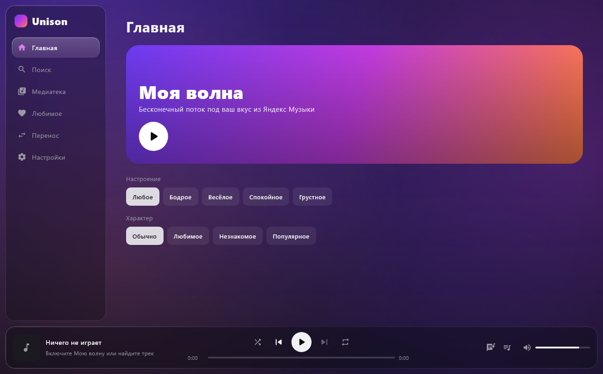
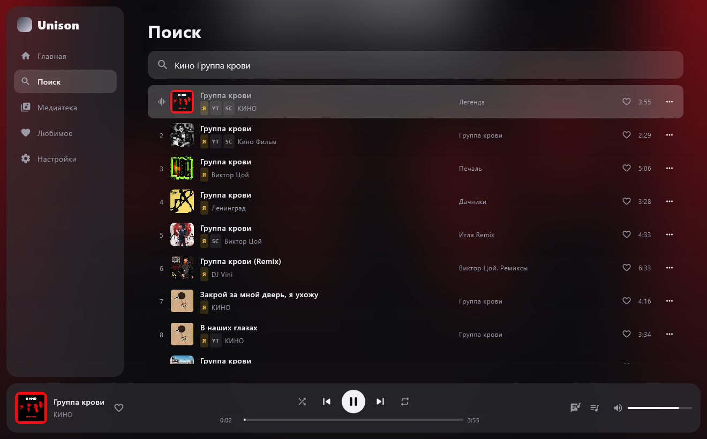
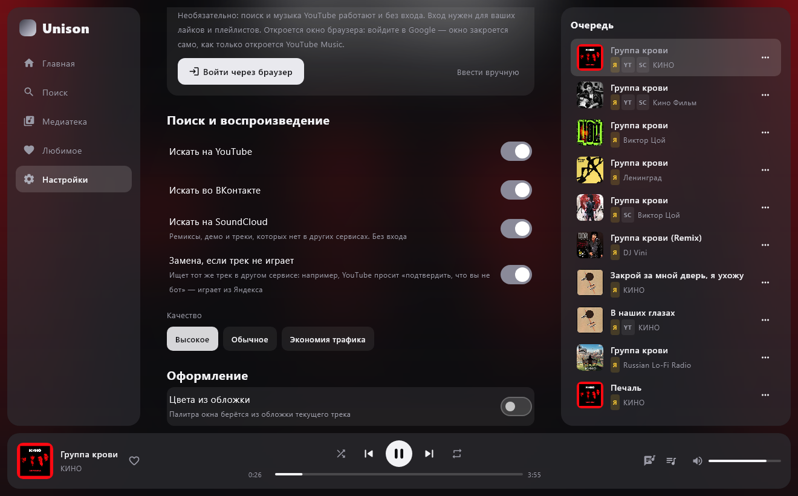
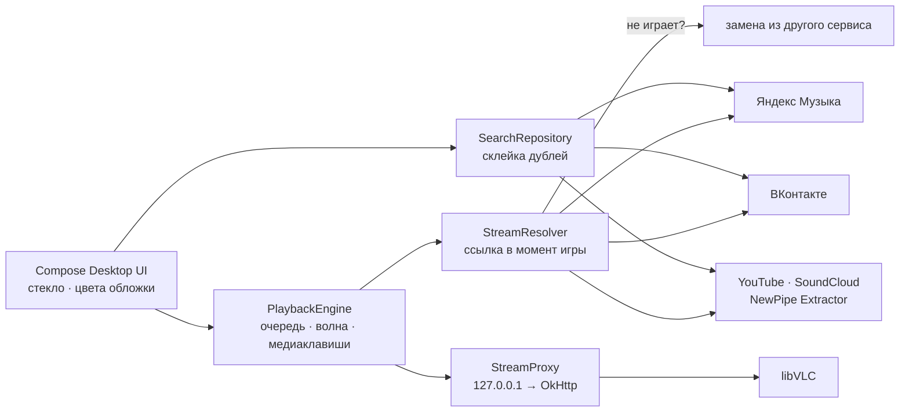

<div align="center">


# Unison для Windows

**Яндекс Музыка, YouTube, SoundCloud и ВКонтакте — в одном плеере на компьютере.**<br/>
Моя волна, единый поиск, перенос плейлистов, синхронные тексты и Liquid Glass.

[](https://github.com/Vexorter42/Unison-Desktop/releases/latest)
[](https://github.com/Vexorter42/Unison-Desktop/releases)


[](LICENSE)

[**Скачать для Windows**](https://github.com/Vexorter42/Unison-Desktop/releases/latest) · [Возможности](#возможности) · [Liquid Glass](#liquid-glass) · [Установка](#установка) · [Обновления](#обновления) · [Сборка](#сборка-из-исходников) · [Unison для Android](https://github.com/Vexorter42/Unison)

<br/>

<table>
  <tr>
    <td></td>
    <td></td>
    <td></td>
  </tr>
  <tr align="center">
    <td><sub><b>Моя волна</b></sub></td>
    <td><sub><b>Единый поиск</b></sub></td>
    <td><sub><b>Liquid Glass</b></sub></td>
  </tr>
</table>

</div>

---

## Возможности

| | |
|---|---|
| **Моя волна** | Рекомендации Яндекса с настроением и характером. Лайки и пропуски уходят в Яндекс и учат волну |
| **Единый поиск** | Ищет сразу в Яндексе, ВК, на YouTube и SoundCloud. Один и тот же трек склеивается в одну строку — со значками `Я` `VK` `YT` `SC` |
| **Умная замена** | Нет подписки, трек удалён или YouTube просит «подтвердить, что вы не бот» — играет копия из другого сервиса |
| **SoundCloud** | Ремиксы, демо и независимые авторы — без входа. Треки только для подписки Go+ пропускаются |
| **Радио по треку** | Бесконечное «похожее» от любой песни из любого сервиса |
| **Медиатека** | «Мне нравится» и плейлисты Яндекса и YouTube Music, «Любимое Unison» — свой плейлист лайков |
| **Перенос** | Плейлист из Яндекса, YouTube, SoundCloud, ВК (из аккаунта или по ссылке) — в Яндекс, YouTube Music или в «Мои плейлисты». Каждый трек ищется по названию, исполнителю и длительности |
| **Мои плейлисты** | Треки из любых сервисов в одном плейлисте |
| **Тексты** | Синхронные тексты песен (LRCLIB) с автопрокруткой, клик по строке — перемотка |
| **Плеер** | Очередь, перемешивание, повтор, громкость запоминается, медиаклавиши клавиатуры |
| **Вход одной кнопкой** | Яндекс, ВК и YouTube Music — в отдельном окне браузера, без копирования токенов |
| **Оформление** | Liquid Glass или классическое тёмное стекло, 11 палитр или цвета из обложки текущего трека |
| **Обновления** | Приложение само находит новую версию на GitHub и ставит её поверх |

### Liquid Glass

Тема в духе iOS 26, как в Android-версии — включается в Настройки → Оформление:

- **настоящее стекло** у боковой панели, плеера и панелей текста и очереди: размывает фон и преломляет его у краёв, с лёгкой хроматической аберрацией (свой шейдер на Skia);
- **пузырь-индикатор** перетекает между вкладками на пружине: в полёте вытягивается, на месте «оседает»;
- **переключатели-капли**: бегунок тянется на ходу, а при нажатии раздувается и становится прозрачной линзой;
- **живой фон** из медленно плавающих цветных пятен, **11 палитр** — или **цвета из обложки** текущего трека.

## Установка

1. Скачайте `Unison-Desktop-x.y.z.msi` (или `.exe`) из [последнего релиза](https://github.com/Vexorter42/Unison-Desktop/releases/latest).
2. Запустите. Установщик не подписан, поэтому Windows может показать «Windows защитила ваш компьютер» — нажмите **«Подробнее» → «Выполнить в любом случае»**.
3. Настройки → войдите в Яндекс и, по желанию, во ВКонтакте и YouTube Music.

Права администратора не нужны: Unison ставится в профиль пользователя. VLC уже внутри — отдельно ставить ничего не надо.

> **Яндекс Музыка:** полные треки — с подпиской Плюс. Без неё Яндекс отдаёт превью, и Unison играет трек с YouTube.
>
> **Вход:** кнопка «Войти через браузер» открывает отдельное окно Chrome или Edge с чистым профилем — без ваших вкладок и паролей. Вы входите сами; когда вход завершён, Unison забирает токен или cookie и закрывает окно, а временный профиль удаляет. Если окно не подходит — «Ввести вручную».
>
> **ВКонтакте:** вход идёт от имени клиента Kate Mobile — иначе VK не отдаёт музыку. ВК иногда ограничивает доступ к аудио, тогда поиск в ВК просто пропускается.

## Обновления

Unison проверяет [релизы этого репозитория](https://github.com/Vexorter42/Unison-Desktop/releases) при запуске и раз в 12 часов. Когда выходит новая версия, внизу боковой панели появляется **«Обновить»**: установщик скачивается, Unison закрывается, новая версия ставится поверх и запускается сама. Проверить вручную — Настройки → Обновления.

Настройки, вход в аккаунты и «Любимое» хранятся отдельно, в `%APPDATA%\Unison`, и при обновлении не трогаются.

## Архитектура



VLC получает поток не напрямую, а через локальный прокси на OkHttp: так работают запасной DNS (DoH, если VPN ломает системный), нужный YouTube User-Agent и перемотка (Range).

<details>
<summary>Структура проекта</summary>

```
src/main/kotlin/com/musichub/
├── desktop/     запуск, окно, медиаклавиши (WinAPI), вход через окно браузера
├── yandex/      API Яндекс Музыки: поиск, лайки, плейлисты, Моя волна
├── vk/          API ВКонтакте (аудио)
├── youtube/     YouTube и YouTube Music через NewPipe Extractor
├── soundcloud/  SoundCloud через NewPipe Extractor
├── search/      объединённый поиск и сопоставление треков между сервисами
├── playback/    плеер на libVLC, локальный прокси потоков, замена источника
├── lyrics/      тексты (LRCLIB)
├── transfer/    перенос плейлистов между сервисами, разбор ссылок
├── update/      обновления через GitHub Releases
├── data/        настройки, «Любимое», свои плейлисты (JSON в %APPDATA%\Unison)
└── ui/          экраны, Liquid Glass, палитры, загрузка обложек
```

Сервисы (Яндекс, ВК, YouTube, поиск, тексты) общие с [Android-версией](https://github.com/Vexorter42/Unison).

</details>

## Сборка из исходников

Нужны JDK 21 и установленный [VLC](https://www.videolan.org/vlc/) 3.x (64-bit) — из него в установщик копируются libvlc и аудиоплагины.

```bash
git clone https://github.com/Vexorter42/Unison-Desktop.git
cd Unison-Desktop
./gradlew run                       # запустить
./gradlew packageMsi packageExe     # установщики → build/compose/binaries/main/{msi,exe}
```

VLC не в `C:/Program Files/VideoLAN/VLC`? Укажите путь: `-PvlcDir=D:/VLC`.

### Проверки

```bash
./gradlew smokeCheck     # поиск, склейка, YouTube/Яндекс/SoundCloud, перемотка, медиаклавиша, текст, Моя волна
./gradlew uiCheck        # настоящий интерфейс без окна: поиск → клик → играет; скриншоты в build/ui-check
./gradlew loginCheck     # окно входа открывается, токен и cookie читаются, окно закрывается само
./gradlew updateCheck    # находит последний релиз и скачивает установщик (без установки)
./gradlew transferCheck  # разбор ссылок и перенос в «Мои плейлисты» (в сервисах ничего не создаётся)
./gradlew shotsCheck     # скриншоты экранов без звука; -Ppalette=0 — на временной копии настроек
```

### Выпуск обновления

Одна команда поднимает версию, собирает `.msi` и `.exe`, коммитит, ставит тег и публикует GitHub Release — установленные копии увидят его как обновление:

```bash
./scripts/release.sh 0.1.2 "Что нового в этой версии"
```

Номер версии должен расти: установщик Windows заменяет только более старую версию.

## Стек

[Kotlin](https://kotlinlang.org) · [Compose Multiplatform](https://www.jetbrains.com/compose-multiplatform/) · [vlcj](https://github.com/caprica/vlcj) + [libVLC](https://www.videolan.org/vlc/libvlc.html) · [OkHttp](https://square.github.io/okhttp/) · [NewPipe Extractor](https://github.com/TeamNewPipe/NewPipeExtractor) · [JNA](https://github.com/java-native-access/jna) · [LRCLIB](https://lrclib.net)

## Дисклеймер

Unison — неофициальный личный проект и не связан с Яндексом, VK, Google или SoundCloud. Он использует неофициальные API, поэтому после обновлений сервисов что-то может перестать работать. Музыку вы слушаете со своих аккаунтов и подписок; приложение не распространяет контент.

## Лицензия

[GPL-3.0](LICENSE) — так же, как у [NewPipe Extractor](https://github.com/TeamNewPipe/NewPipeExtractor), на котором работают YouTube и SoundCloud. В установщик входит [libVLC](https://www.videolan.org) (LGPL-2.1).
